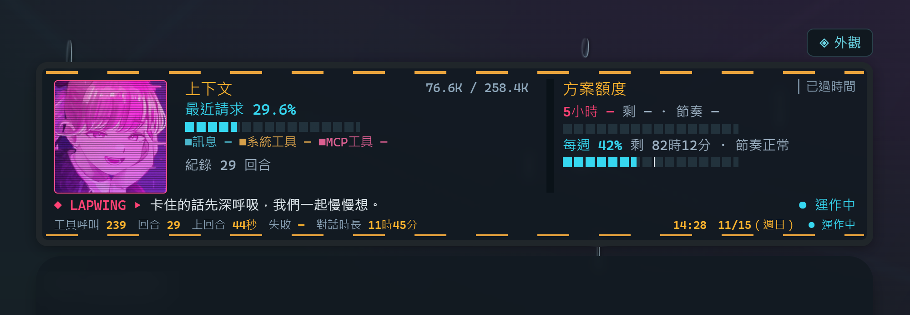

# Interlinked · Codex 夜城 HUD



繁體中文 | [English](docs/README.en.md)

將 [Claude 主題](https://github.com/xiangerwu/claude-theme-icanfixthat) 的夜城配色、格線背景、向下掃描光與 LAPWING HUD 移植到 Codex 桌面版。這是本地實驗性主題，透過 CodeDrobe Core 套用，不修改 Codex 安裝檔。

## 外觀與資料

- 獨立 HUD：頭像與掃描紋、上下文／方案額度分欄、分段進度條、角色語句與底列。
- 背景掃描光位於對話、HUD 和輸入框後方。遠處大樓輪廓、窗燈與屋頂霓虹位於格線後方；兩者一起透過霧玻璃模糊。
- 缺少資料時顯示 `—`，不填入示範或隨機數值。

| 欄位 | 真實來源與限制 |
| --- | --- |
| 最近請求 token／上限 | 目前對話事件的 `last_token_usage.total_tokens / model_context_window`；不是精確即時上下文占用 |
| 5 小時／每週額度 | 事件最後回報的 `rate_limits`，依 300／10080 分鐘辨識；未回報或已過重置時間即顯示 `—` |
| 重置倒數／時間標記 | 依回報的重置時間與視窗長度計算；節奏比較使用量與已過時間，容許 10 個百分點差距 |
| 工具呼叫 | 事件紀錄中去重後的外層 `function_call`／`custom_tool_call`；不計算 orchestrator 內部每個操作 |
| 回合／上回合耗時 | `task_started`／`task_complete.duration_ms` |
| 對話時長 | 從工作階段開始到現在，包含閒置時間 |
| 狀態／日期時間 | 最近生命週期事件／系統時鐘 |
| token 類別拆分、失敗次數 | 沒有可靠來源，目前保留 `—` |

只讀取原生側欄所選取的本地對話及其 `~/.codex/sessions` 事件檔。會驗證對話 ID，切換或資料失效時清空，不讀取帳號憑證，不向外傳送聊天內容。額度是事件回報快照，滑鼠移到額度區可查看回報時間，並非即時帳戶 API 查詢。

## 外觀控制面板

HUD 上方右側的 **◈ 外觀** 可開啟面板，隱藏 HUD 後入口仍保留。設定即時套用並保存在目前 Codex 本機儲存空間；關閉面板不會取消設定。按 Esc 或關閉按鈕收起，可恢復預設。

- 遠景與雨景：顯示大樓開關（預設開啟）、玻璃雨滴開關、雨量、落下速度。使用 CSS 水滴近似濕玻璃，沒有流體模擬。
- 光與玻璃：右上柔和光源開關／亮度／自訂顏色（預設暖黃）；霧玻璃同時模糊遠處背景線條及 HUD／輸入框的背後畫面，模糊半徑由霧化滑桿控制。文字與水滴保持清楚。
- 掃描與 HUD：背景掃描線開關／週期，HUD 顯示／80–110% 大小。掃描與雨景都在內容後方。
- 上邊框：流動亮邊，與雨景共用動畫開關。

預設雨景關閉、霧玻璃和光源開啟。系統啟用「減少動畫」時，雨景／邊框預設暫停，可在面板明確開啟本主題例外；不更改系統設定。掃描線保留先前允許的獨立動畫例外，可隨時關閉。

套用主題後執行 `node controls.test.mjs`，會實際切換本主題控制、檢查動畫／排版／Esc／儲存／預設值，並還原執行前設定；需要 CDP 9335。截圖 `.runtime/controls-actual.png` 僅保留本地。

## 安裝

目前實測：Windows、Codex `26.1111.2228.0`、CodeDrobe Core `0.6.1`。需要 Node.js 22.4+、npm、Git。首頁與窄視窗仍未完整驗證；Codex 或 Core 更新可能需要重新適配。

```powershell
npm install --global @codedrobe/core@0.6.1
git clone https://github.com/xiangerwu/codex-theme-icanfixthat.git
cd codex-theme-icanfixthat
node telemetry.test.mjs
node install.mjs
node pack.mjs
codedrobe apply --app codex --port 9335 --theme ./dist/interlinked-codex.codedrobe-theme --watch --restart-existing
```

最後一行會重啟 Codex，請先保存工作並在**外部終端機**執行。保持該終端機開啟，只執行一個 watcher。已開啟 CDP 的工作階段可改用 `--no-launch`，省略 `--restart-existing`。

`install.mjs` 只接受 Core 0.6.1。首次安裝前備份要修改的三個 Core 檔案到 `backup-install-時間戳/`；遇到不相符的內容會停止。它會套用視窗辨識、HUD profile 和讀取事件的 watcher 修補，並同步 `telemetry.mjs`。這些修補是完整 HUD 必需的一部分，單獨匯入 `.codedrobe-theme` 不會安裝它們。

## 從開始選單啟動並套用（Windows）

重開機後改用開始選單的 **Codex 夜城**。它會先透過 CodeDrobe 開啟 Codex 的本機 CDP 9335，確認介面就緒，再啟動一個背景 watcher。完整關閉 Codex 後，這個入口所建立的 watcher 也會結束。

完成上方安裝與封裝後，執行一次建立捷徑（不需系統管理員）：

```powershell
powershell.exe -NoProfile -ExecutionPolicy RemoteSigned -File .\launch-theme.ps1 -InstallShortcut
```

這不是 Windows 登入自動啟動；登入不會自行開啟 Codex。原生 Codex 圖示不會啟動主題 watcher，請使用「Codex 夜城」，也可以將該捷徑釘選到工作列。捷徑指向本專案，搬移專案後重新執行安裝指令。

若 Codex 已由原生入口開啟且沒有 CDP，捷徑會提示先完整關閉再開，不會自行中斷工作。需要明確重啟並套用時，在外部終端機執行：

```powershell
powershell.exe -NoProfile -ExecutionPolicy RemoteSigned -File .\launch-theme.ps1 -RestartExisting
```

重複點擊不會新增第二個 watcher。啟動診斷記錄保存在本機忽略目錄 `.runtime/`，包括 `launcher.log`、`launch.err.log`、`probe.log` 和 `watcher.err.log`。只檢查依賴／路徑而不啟動可使用 `-Check`。在主題已開啟時執行 `powershell.exe -NoProfile -ExecutionPolicy RemoteSigned -File .\launcher.test.ps1`，可回歸檢查實際捷徑與單一 watcher。停用此啟動入口可從開始選單移除「Codex 夜城」捷徑；不需要移除登入項，因為沒有建立。

## 頭像與私人檔案

公開 repo 僅包含本頁展示用的 HUD 截圖，**不含獨立私人頭像檔、其他實機截圖、DOM 快照、備份或封裝產物**。沒有頭像時顯示 `NO SIGNAL`。

若有權使用自己的圖片，可放入 `assets/portrait.jpg` 或 `assets/portrait.png`，再執行 `node pack.mjs`。本地封裝會包含圖片；請勿公開帶有未授權素材的 `dist/`。頭像、`theme.local.json`、`dist/` 都已加入 `.gitignore`。

格線與配色在 `assets/` 和 `codex.css`，HUD 結構在 `patches/core-0.6.1.patch`，數據讀取器為 `telemetry.mjs`。若修改數據讀取器，重新執行 `node install.mjs` 並重啟 watcher。

掃描光預設 16 秒一輪，可從控制面板調整或關閉，無須修改 CSS 或重新封裝。

## 驗證與還原

```powershell
node telemetry.test.mjs
codedrobe probe --app codex --port 9335 --theme ./dist/interlinked-codex.codedrobe-theme
codedrobe verify --app codex --port 9335 --theme ./dist/interlinked-codex.codedrobe-theme
```

先在 watcher 終端機按 `Ctrl+C`，再執行：

```powershell
codedrobe restore --app codex --port 9335
```

若回報 `restart-required`，完整關閉並重開 Codex。要還原 Core 程式碼，將安裝時 `backup-install-時間戳/` 中三個檔案依原相對路徑複製回全域 `@codedrobe/core` 目錄（可用 `npm root -g` 找到）。還原前不要執行 watcher。

本專案程式碼採 MIT；Core 修補衍生自 Apache-2.0 的 `@codedrobe/core`，授權與聲明保留於 `patches/`。私人頭像不在這些授權範圍內。
